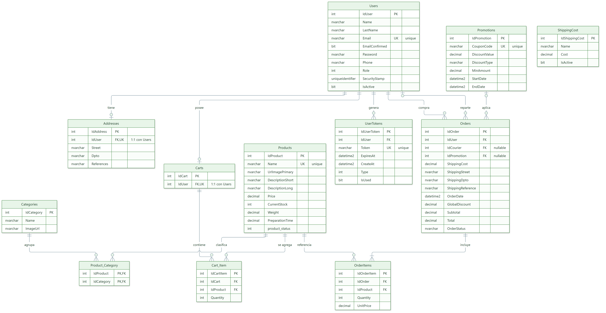

# GreenCongelados

Backend de un e-commerce de productos congelados con entrega a domicilio en Rosario.

## 1. Visión general

### Problema de negocio

El sistema resuelve la operación completa de una tienda de congelados: publicar un catálogo con stock real, permitir que el cliente arme un carrito y compre, aplicar cupones de descuento, calcular el envío y coordinar la entrega con cadetes. El foco está en que el stock y el estado de los pedidos sean confiables: no se puede vender dos veces la última unidad ni devolver stock dos veces al cancelar.

### Funcionalidades principales

- **Catálogo**: productos con precio, stock, peso, tiempo de preparación, imagen y categorías (relación muchos a muchos). Los productos pueden ocultarse, publicarse o eliminarse de forma lógica sin perder el historial de pedidos.
- **Carrito**: un carrito por usuario, con alta, edición por ítem o por producto, eliminación y validación de stock acumulado antes de confirmar.
- **Checkout y pedidos**: el pedido se crea desde el carrito, descuenta stock de forma atómica, guarda una foto del precio unitario y de la dirección de envío, aplica promoción y calcula subtotal, descuento y total. Al cancelar, el stock se restituye una sola vez.
- **Logística**: estados `LogisticsPending`, `InDelivery`, `Delivered` y `Cancelled`; asignación de cadete, actualización de estado por parte del cadete y devolución del pedido a la cola de logística si la entrega falla.
- **Promociones**: cupones con código único, vigencia por fechas, monto mínimo y descuento porcentual, fijo o envío gratis.
- **Envío**: costo de envío configurable, con un único registro activo a la vez.
- **Cuentas y seguridad**: roles `SUPERADMIN`, `ADMIN`, `USER` y `CADET`; registro con confirmación por correo, login con JWT, recuperación de contraseña, cambio de rol con jerarquía y baja lógica de cuenta.

### Stack tecnológico

- **.NET 8** y **ASP.NET Core Web API** con controladores.
- **Entity Framework Core 8** sobre **SQL Server**, con migraciones y un seeder de datos demo idempotente.
- **JWT Bearer HS256** (`Microsoft.AspNetCore.Authentication.JwtBearer`, `System.IdentityModel.Tokens.Jwt`).
- **BCrypt.Net-Next** para el hash de contraseñas.
- **MailKit / MimeKit** para el envío de correos por SMTP.
- **Swagger / Swashbuckle** con esquema de autenticación Bearer.
- Configuración por `appsettings`, User Secrets y variables de entorno, validada al arrancar.

## 2. Arquitectura y decisiones técnicas

### Estructura de capas

| Proyecto | Responsabilidad | Depende de |
|---|---|---|
| `Domain` | Entidades, enums, invariantes de negocio, interfaces de repositorio y excepciones de dominio. No conoce EF Core ni ASP.NET. | — |
| `Application` | Casos de uso, DTOs, validadores, opciones de configuración e interfaces de servicios y seguridad. | `Domain` |
| `Infrastructure` | `DbContext` de EF Core, repositorios, Unit of Work, proveedores de seguridad, envío de correo, migraciones y seeder. | `Domain`, `Application` |
| `Web` | Controladores, middleware de errores, composición de dependencias y arranque de la API. | `Application`, `Infrastructure` |

La dirección de dependencias va hacia el dominio. Las entidades no dependen de la persistencia; las reglas de stock, precios, estados y promociones viven en `Domain`.

### Patrones aplicados

- **Repository + Unit of Work**: `IGenericRepository<T>` para CRUD y repositorios específicos cuando la consulta lo requiere. `IUnitOfWork` centraliza `SaveChanges` y las transacciones explícitas.
- **Servicios de aplicación con interfaces segregadas**: cada módulo expone `I...ReadOnlyService` e `I...WriteService`, implementados por una misma clase. Separa lectura de escritura sin introducir CQRS completo.
- **Entidades de dominio con invariantes**: constructores y métodos validan las reglas (`Product.SyncStatusWithStock`, `Order.Create`, `User.ChangeRole`), con setters privados y `AppValidationException` para errores de negocio.
- **DTOs como contrato**: las entidades no se exponen directamente; los DTOs se construyen con factories (`ProductDTO.Create`, `OrderDTO.Create`).
- **Errores uniformes**: `AppValidationException` transporta mensaje, código y status HTTP; un middleware global los traduce a `{ error, code }`. Los errores de validación de `DataAnnotations` usan el mismo contrato.
- **Options pattern**: `UserTokenOptions` y `SmtpOptions` se validan con `ValidateOnStart`, de modo que la API no arranca con configuración incompleta.
- **Decorator para correo**: `BestEffortEmailSender` envuelve al sender SMTP para que un fallo de envío no revierta la operación ya confirmada; en Development sin credenciales se usa `ConsoleEmailSender`.

### Decisiones clave

1. **Stock por compare-and-swap en SQL** ([ADR 0001](docs/adr/0001-concurrencia-de-stock.md)). El descuento en checkout y la cancelación se resuelven con un `UPDATE` condicional (`ExecuteUpdateAsync`) cuyo `WHERE` valida estado y stock. Si `rowsAffected == 0`, se devuelve `409`. La transacción abre antes del primer decremento, los decrementos se ordenan por `IdProduct` para evitar deadlocks y las lecturas de validación usan `AsNoTracking`. Se descartó `RowVersion`: el conflicto de stock no es reintentable.

2. **Sesiones JWT de una hora con `security_stamp` persistido** ([ADR 0002](docs/adr/0002-sesiones-jwt-security-stamp.md)). El token incluye el stamp del usuario; `OnTokenValidated` lo compara contra la base en cada request. Cambiar contraseña, cambiar rol o desactivar la cuenta rota el stamp y revoca las sesiones al instante. No hay refresh token ni almacén de sesiones; el costo aceptado es una consulta a la base por request autenticado y un re-login cada hora. `ValidateIssuer` y `ValidateAudience` están desactivados para el escenario de un único servicio.

3. **Estado de producto derivado del stock, salvo excepciones explícitas** ([ADR 0003](docs/adr/0003-estado-de-producto.md)). `Available` y `OutOfStock` se calculan desde `CurrentStock`; `Hidden` y `Deleted` son decisiones manuales que el stock no modifica. El estado se persiste para poder filtrar y listar en SQL, y las rutas con `ExecuteUpdate` replican la derivación en SQL.

4. **Operaciones críticas en una sola transacción**. El alta de usuario y su carrito, el checkout (descuento de stock + creación del pedido + vaciado del carrito) y la cancelación (cambio de estado + restitución de stock) son atómicos. El envío de correos ocurre después del commit y es best-effort.

5. **Integridad en la base**. Índices únicos para email de usuario, nombre de producto, código de cupón y token de usuario; una dirección por usuario; una línea por producto y carrito. `OrderItem` guarda el precio unitario del momento de la compra y `Order` guarda la dirección de envío, para que los cambios posteriores no alteren el historial.

6. **Tokens de usuario hasheados y de un solo uso**. Los tokens de confirmación y de recuperación se generan con `RandomNumberGenerator`, se guardan como SHA-256, tienen vencimiento configurable y se invalidan al reutilizarse o al emitir uno nuevo. Los endpoints públicos de reenvío y recuperación no revelan si el email existe.

### Modelo de datos

El modelo cubre usuarios, direcciones, carrito e ítems, productos y categorías, pedidos e ítems, promociones, costos de envío y tokens de usuario. Las relaciones muchos a muchos y los índices únicos se configuran en `Infrastructure/Persistence/DbContext.cs`.

### Documentación de decisiones

- [ADR 0001 — Concurrencia de stock y transiciones de estado](docs/adr/0001-concurrencia-de-stock.md)
- [ADR 0002 — Sesiones JWT de una hora con security_stamp persistido](docs/adr/0002-sesiones-jwt-security-stamp.md)
- [ADR 0003 — Estado de producto derivado del stock](docs/adr/0003-estado-de-producto.md)
